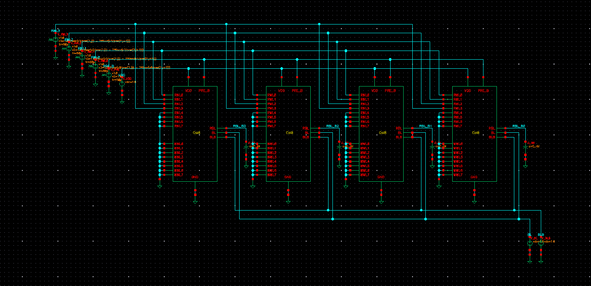

# 8T SRAM CIM MAC

A 4×4 multiply-accumulate computed inside an 8T SRAM array, designed in Cadence Virtuoso and simulated with
Spectre at 180 nm.



## Design

| Item | Value |
|---|---|
| Process | gpdk180, 1.8 V, typical corner, 27 °C |
| Cell | 8T SRAM: 6T storage + 2-transistor read port, all 2u/180n |
| Column | 8 cells on one read bitline, 4 pF load |
| MAC | 4 columns, 4-bit weights × 4-bit inputs, 4 cycles |
| Read | 1 ns read pulse, bitline sampled at 8 ns |

## How it works

- **Cell:** pulls the read bitline down only when its row is read and it stores 1, so each cell is a 1-bit multiply.
- **Column:** reading several rows at once adds their currents, so the bitline voltage is a count of the 1s.
- **MAC:** column *c* holds bit *c* of every weight and cycle *j* reads bit *j* of every input; the count from
  column *c* in cycle *j* is worth 2<sup>j+c</sup>, and adding them up gives the MAC.

## Results

| Test | Result |
|---|---|
| MAC, w = (15, 10, 5, 3), x = (15, 6, 9, 12) | 366 from memory, 366 exact |
| MAC, w = x = (15, 15, 15, 15) | 900 from memory, 900 exact |
| Column, 0 to 8 rows read | 9 levels, 1.80 V to 0.35 V, steps of 198 to 140 mV |
| Column, 2 operands | NOR, XOR and AND from one read |

Plots and tables: [results/README.md](results/README.md).

## Opening the design

Needs Cadence Virtuoso with the gpdk180 kit. Add this line to your `cds.lib`:

```
INCLUDE <path to repo>/design/cds.lib
```

## Decode

```sh
python3 scripts/decode.py    # bitline voltages in results/ -> counts, logic and MAC
```

| Folder | What it is |
|---|---|
| [design](design/README.md) | Virtuoso library `sram8t_cim`: cells and testbenches |
| [sim](sim/README.md) | Netlists and the data stored in the cells |
| [scripts](scripts/README.md) | Decodes the results |
| [results](results/README.md) | Measured voltages, waveforms and plots |
| assets | Schematic and waveform images used in the READMEs |

## References

- Amogh K M and Sunita M S, "A Novel 8T SRAM-Based In-Memory Computing Architecture for MAC-Derived Logical
  Functions", [arXiv:2512.00441](https://arxiv.org/abs/2512.00441), 2025.
