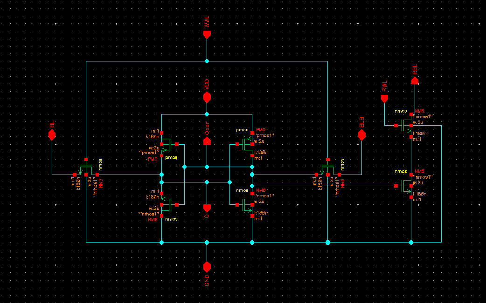
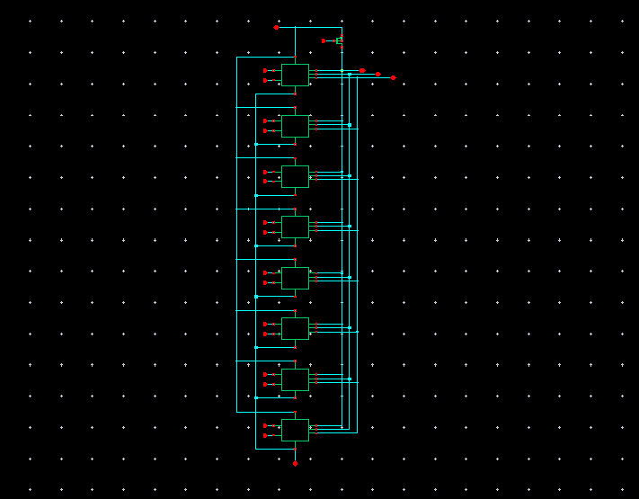
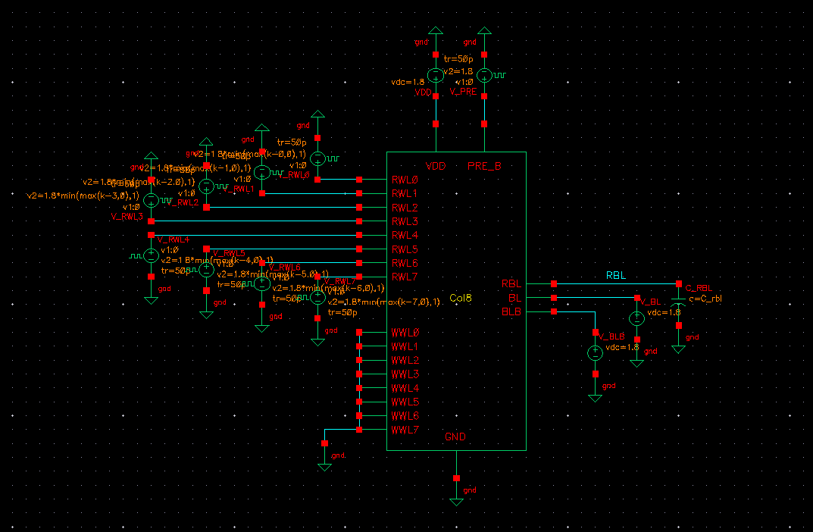
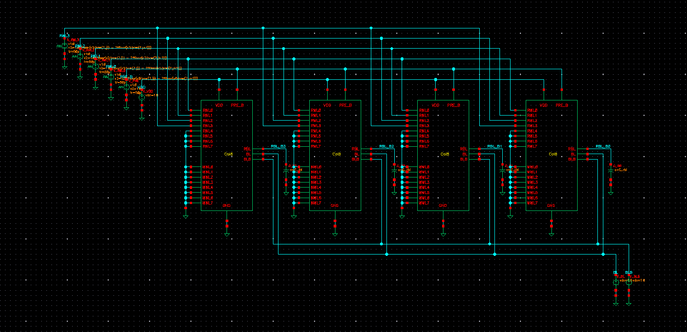

# Design

Cadence library `sram8t_cim`. To open it, add `INCLUDE <path to repo>/design/cds.lib` to your `cds.lib`.

| Cell | What it is |
|---|---|
| `sram8t` | 8T bitcell. Pulls RBL down when RWL is high and it stores 1 (Q = 0, Qbar = 1.8 V). |
| `cim_column8` | 8 bitcells on one read bitline, plus the precharge PMOS. |
| `tb_sram8t` | Bitcell write and read. |
| `tb_cim_column8` | One column: count sweep and Boolean logic. |
| `tb_mac4x4` | Four columns sharing the read wordlines: the 4×4 MAC. |

All transistors are `nmos1` / `pmos1` at 2u/180n, with NMOS bulks on GND and PMOS bulks on VDD.

