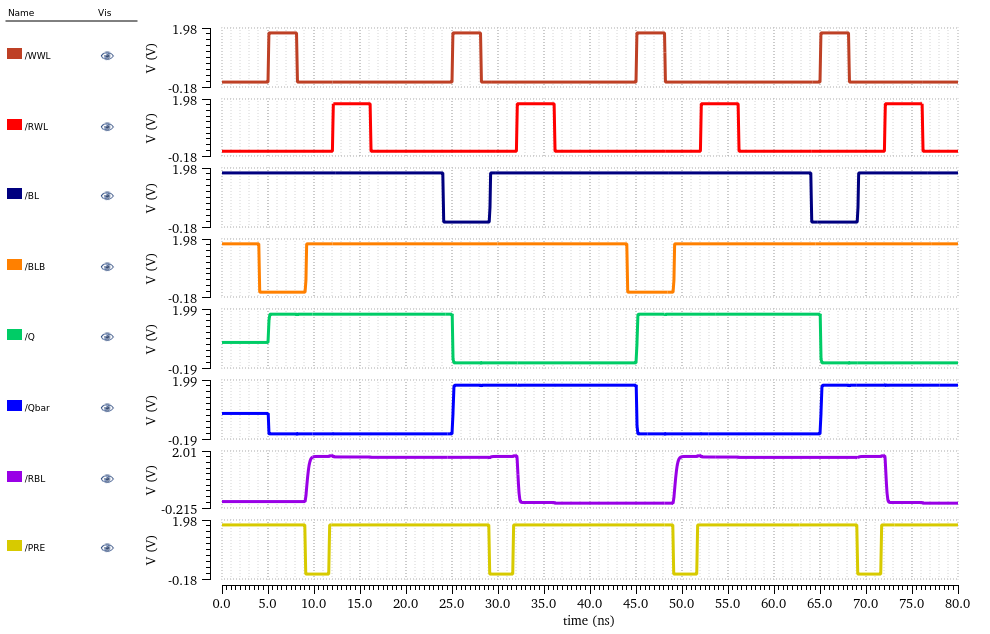
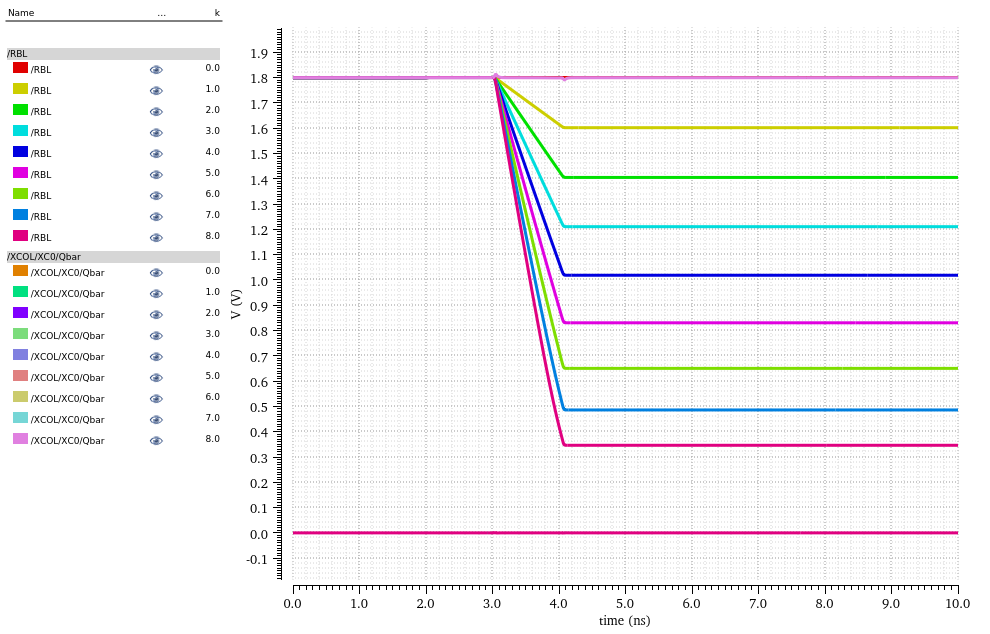
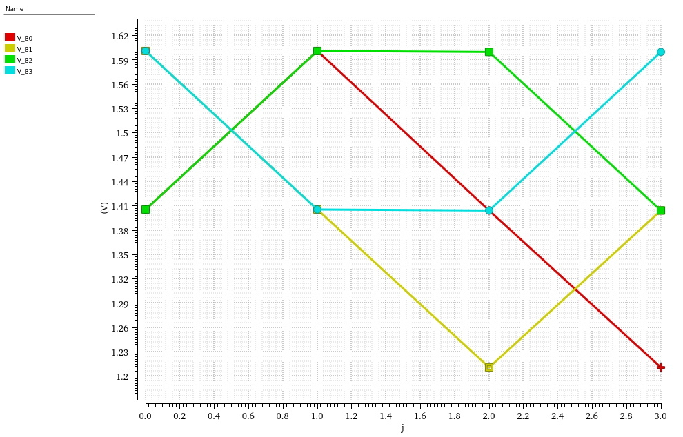
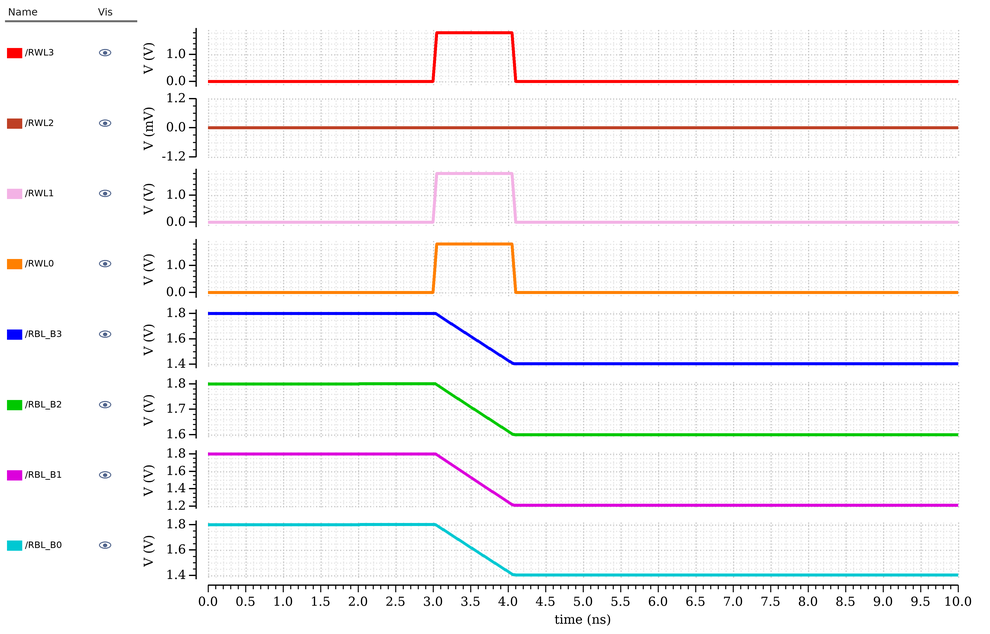

# Results

1.8 V, 27 °C, bitline voltage taken at 8 ns. `python3 scripts/decode.py` turns the voltages into the counts and
results below.

| File | What it has |
|---|---|
| `bitcell_write_read.csv` | Bitcell waveforms, 0 to 80 ns. |
| `column8_count_sweep.csv` | Bitline level for 0 to 8 rows read. |
| `column8_count_sweep_waveforms.csv` | Bitline waveform for each count. |
| `column8_boolean.csv` | Bitline level for each A, B. |
| `mac4x4_default.csv` | Bitline level of each column in each cycle, w = (15, 10, 5, 3), x = (15, 6, 9, 12). |
| `mac4x4_worst_case.csv` | The same for w = x = (15, 15, 15, 15). |
| `mac4x4_cycle2_waveforms.csv` | Read wordlines and bitlines in cycle 2. |

## Bitcell

Writes 1 at 5 ns and 0 at 25 ns. On a read the bitline stays high for a stored 1 and drops for a stored 0.

## Count sweep

All 8 cells store 1 and k rows are read at once. Each extra row drops the bitline by about 200 mV.

| k | 0 | 1 | 2 | 3 | 4 | 5 | 6 | 7 | 8 |
|---|---|---|---|---|---|---|---|---|---|
| Bitline (V) | 1.801 | 1.602 | 1.406 | 1.211 | 1.019 | 0.831 | 0.650 | 0.485 | 0.346 |
| Step (mV) | | 198 | 197 | 195 | 192 | 188 | 180 | 165 | 140 |

Steps shrink at high counts as the read transistors leave saturation.

## Boolean

A in row 0, B in row 1, both read together. The count is the result.

| A | B | Bitline (V) | Count | NOR | XOR | AND |
|---|---|---|---|---|---|---|
| 0 | 0 | 1.798 | 0 | 1 | 0 | 0 |
| 0 | 1 | 1.601 | 1 | 0 | 1 | 0 |
| 1 | 0 | 1.601 | 1 | 0 | 1 | 0 |
| 1 | 1 | 1.406 | 2 | 0 | 0 | 1 |

## 4×4 MAC

w = (15, 10, 5, 3), x = (15, 6, 9, 12), exact result 366.

Column XB*c* holds bit *c* of each weight:

| | XB3 | XB2 | XB1 | XB0 |
|---|---|---|---|---|
| w0 = 15 | 1 | 1 | 1 | 1 |
| w1 = 10 | 1 | 0 | 1 | 0 |
| w2 = 5 | 0 | 1 | 0 | 1 |
| w3 = 3 | 0 | 0 | 1 | 1 |

Cycle *j* reads the rows whose input has bit *j* set. Each count is worth 2j+c:

| Cycle | Rows read | XB3 | XB2 | XB1 | XB0 | Sum |
|---|---|---|---|---|---|---|
| 0 | 0, 2 | 1 | 2 | 1 | 2 | 20 |
| 1 | 0, 1 | 2 | 1 | 2 | 1 | 50 |
| 2 | 0, 1, 3 | 2 | 1 | 3 | 2 | 112 |
| 3 | 0, 2, 3 | 1 | 2 | 2 | 3 | 184 |
| | | | | | MAC | 366 |

Cycle 2: rows 0, 1 and 3 are read and each bitline drops about 200 mV per cell that stores 1.

Worst case, w = x = (15, 15, 15, 15): every column counts 4 in every cycle, MAC = 900, exact.
